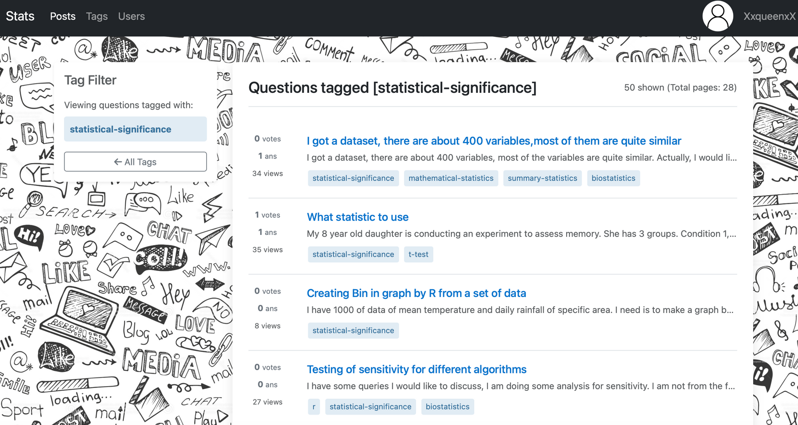
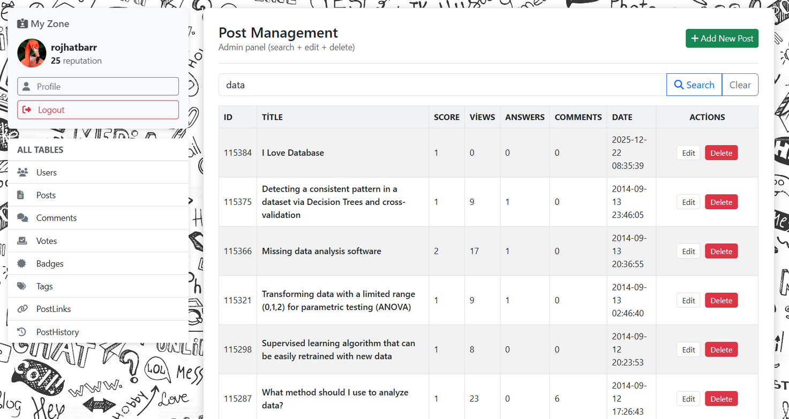
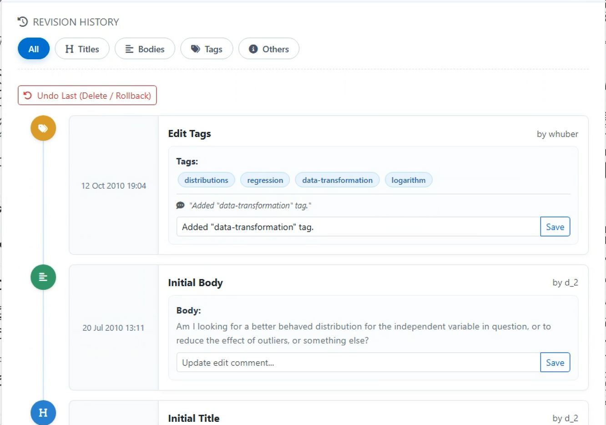

# DataThieves

A Q&A forum in the style of Stack Exchange, built with Flask on a normalized MySQL database filled
with real data from [Cross Validated](https://stats.stackexchange.com) (the statistics Q&A site).
Team project for a database systems course at Istanbul Technical University, Fall 2025.



## Features

- **Forum:** questions and answers with search, tag filters, sorting and pagination; answers are
  posted without a page reload (AJAX).
- **Votes, favorites and comments:** up/down votes and favorites via AJAX, with duplicate votes blocked.
- **Revision history:** a timeline of every edit to a post, filterable by titles, bodies and tags,
  with editable edit comments and an undo of the last revision.
- **Users and badges:** profiles, predefined or custom badges with a duplicate check, and a
  top-100 users ranking built from a nested SQL query.
- **Admin panel:** pages to browse and manage users, posts, badges, tags, post links and post
  history, with search and pagination; other users get HTTP 403.

| Admin post management | Revision history |
|---|---|
|  |  |

## Database

Eight tables follow the Stack Exchange data dump: `Users`, `Posts` (questions and answers),
`Comments`, `Votes`, `Badges`, `Tags`, `PostLinks` and `PostHistory`. The ER diagram, the relational
mapping and the normalization steps are in [`presentation.pdf`](presentation.pdf).

The data comes as a MySQL dump. It is not in the repository because of its size. `tables.py`
creates the database, imports the dump with the `mysql` command-line client and applies the
post-import schema changes.

## Project structure

```
app.py            app factory, config from .env, blueprint registration, home page
extensions.py     shared Flask-MySQLdb instance
tables.py         creates the database and imports the SQL dump
blueprints/
  posts.py            forum, questions and answers, login and register
  comments_votes.py   comments, votes, favorites
  users_badges.py     users, profiles, badges, top users
  tags_postlinks.py   tags, tagged questions, post links
  post_history.py     revision timeline, undo, admin history table
utils/auth.py     login_required and admin_required decorators
templates/, static/
tests/            pytest tests with an in-memory fake of MySQL
```

## Running it locally

You need Python 3 (tested with 3.13) and MySQL 8.

```bash
pip install flask flask-mysqldb wtforms python-dotenv mysql-connector-python pytest
```

Create a `.env` file in the project root:

```
MYSQL_HOST=127.0.0.1
MYSQL_PORT=3306
MYSQL_USER=root
MYSQL_PASSWORD=your-password
MYSQL_DB=local_stats
MYSQL_DUMP_FILE=stats_yedek.sql
SECRET_KEY=change-me
```

Import the data, then start the app:

```bash
python tables.py   # set MYSQL_BIN in tables.py if mysql is not at the MySQL Workbench path
python app.py      # http://127.0.0.1:5001
```

## Tests

```bash
pytest
```

Four tests run against a fake database, so no MySQL server is needed. They cover admin access
control (a non-admin gets 403 on `/users`), the admin users page, login being required to add a
badge, and the warning for a duplicate badge. They pass on Python 3.13.

## Known limitations

This is a course project, not a production app:

- Login checks the user ID and display name; there are no passwords.
- Admin accounts are a fixed list of user IDs in `blueprints/posts.py`.
- The default secret key and database password in `app.py` are for local development only.

## Team

| Member | Area |
|---|---|
| Rojhat Baran ([@itu-itis23-baranr22](https://github.com/itu-itis23-baranr22)) | Posts and forum pages, project setup and blueprint structure |
| Ebrar Gözde Taştekin ([@itu-itis23-tastekine22](https://github.com/itu-itis23-tastekine22)) | Tags and post links |
| Elif Züleyha Taçyıldız ([@itu-itis23-tacyildiz22](https://github.com/itu-itis23-tacyildiz22)) | Comments and votes |
| Hakan Taha Işık ([@itu-itis23-isikha22](https://github.com/itu-itis23-isikha22)) | Users and badges |
| Aleyna Polat ([@aleyna-polat](https://github.com/aleyna-polat)) | Post history |

## Data license

The forum content is from the Stack Exchange data dump of Cross Validated, licensed under
[CC BY-SA](https://creativecommons.org/licenses/by-sa/4.0/) by its original authors.
